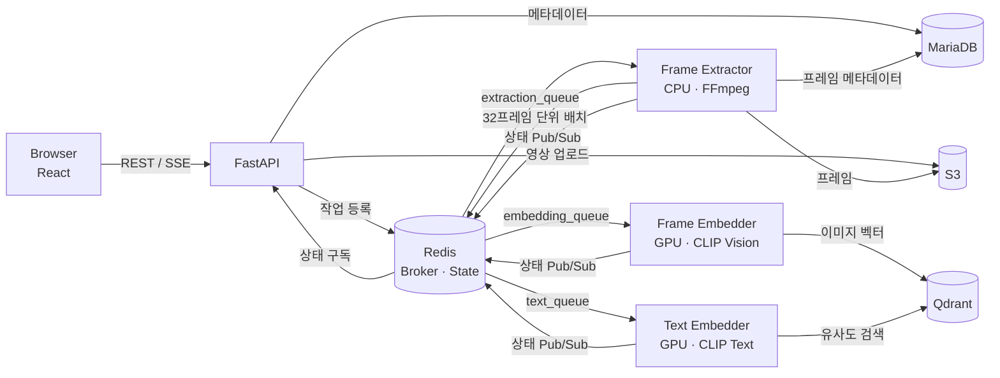
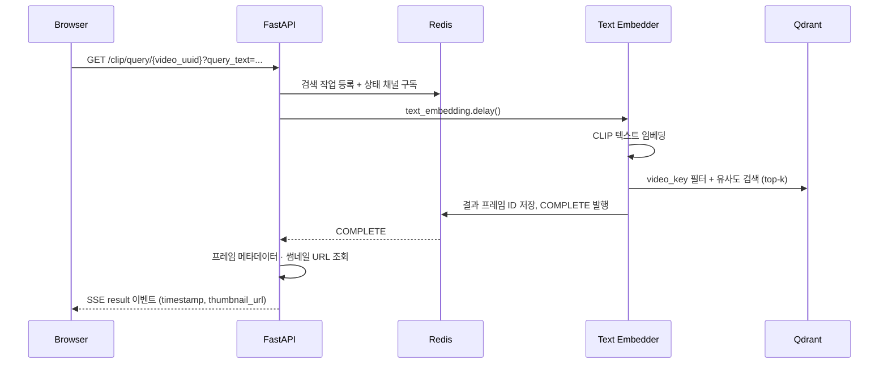

# CLIP Search

> 자연어 검색어로 영상 속 원하는 장면을 찾아주는 서비스

영상을 업로드하면 1초 간격으로 프레임을 추출해 [CLIP](https://openai.com/research/clip) 이미지 임베딩으로 변환하고, 사용자가 입력한 문장과 의미적으로 가장 가까운 장면을 찾아 해당 시점으로 바로 이동할 수 있게 해 줍니다.
"빨간 차가 지나가는 장면"처럼 태그나 자막 없이도 영상 내용을 검색할 수 있습니다.

<!-- TODO: 데모 GIF (업로드 → 처리 상태 → 검색 → 썸네일 클릭 시 재생 위치 이동) -->
<!--  -->

## 주요 기능

- **자연어 장면 검색**: 검색어를 CLIP 텍스트 임베딩으로 변환해 Qdrant에서 코사인 유사도가 높은 프레임을 찾고, 썸네일을 클릭하면 해당 시점부터 재생
- **비동기 영상 처리 파이프라인**: Celery 작업자가 프레임 추출과 임베딩 생성을 역할별 큐로 나눠 병렬 처리
- **실시간 처리 상태 표시**: Redis Pub/Sub과 Server-Sent Events(SSE)로 처리 상태를 브라우저에 실시간 전달
- **처리 중 삭제(취소) 지원**: 처리 중인 영상을 삭제하면 진행 중인 작업이 중단되고 생성된 프레임·벡터·파일까지 정리
- **JWT 인증**: HttpOnly 쿠키 기반 로그인, 사용자별 영상 관리

## 기술 스택

| 영역 | 기술 |
| --- | --- |
| Frontend | React 19, TypeScript, Vite |
| API 서버 | FastAPI, SQLAlchemy(async), Pydantic |
| 비동기 작업 | Celery, Redis(브로커 · 진행 상태 · Pub/Sub) |
| AI 모델 | Hugging Face Transformers, PyTorch, `openai/clip-vit-base-patch32` |
| 저장소 | MariaDB(메타데이터), Qdrant(벡터), AWS S3(영상 · 프레임) |
| 영상 처리 | FFmpeg |
| 인프라 | Docker, Kubernetes(Kustomize) |

## 아키텍처



작업자는 리소스 특성에 따라 세 종류로 분리했습니다. FFmpeg 기반 프레임 추출은 CPU 노드에서 동시성을 높여 실행하고, CLIP 추론은 GPU 노드에서 실행하도록 Kubernetes node affinity로 배치합니다.

### 영상 처리 흐름

1. API 서버가 영상 메타데이터를 MariaDB에 저장하고, 영상 파일을 S3에 업로드한 뒤 프레임 추출 작업을 등록합니다.
2. **Frame Extractor**가 S3 presigned URL을 FFmpeg에 바로 입력해 1초 간격으로 프레임을 추출합니다. 32프레임이 모일 때마다 메타데이터를 DB에 기록하고 프레임 이미지를 S3에 올린 뒤 임베딩 작업을 등록합니다.
3. **Frame Embedder**가 배치 단위로 CLIP 이미지 임베딩을 생성해 `video_key` 등의 payload와 함께 Qdrant에 저장합니다.
4. 추출된 프레임 수와 임베딩된 프레임 수를 Redis에서 집계하다가, 두 값이 같아지면 영상 상태를 `COMPLETE`로 전환하고 Pub/Sub으로 알립니다.

추출과 임베딩이 배치 단위로 맞물려 진행되므로, 영상 전체 추출이 끝나기를 기다리지 않고 임베딩이 시작됩니다.

### 검색 흐름



GPU 모델은 작업자 프로세스에만 올리고 API 서버는 가볍게 유지하기 위해, 텍스트 임베딩도 Celery 작업으로 처리하고 API는 Redis 채널을 구독해 결과를 기다립니다.

## 구현 포인트

### FFmpeg 출력 스트리밍
프레임을 디스크에 저장하지 않고 FFmpeg의 `image2pipe` 출력을 직접 읽습니다. 표준 출력 버퍼에서 JPEG의 SOI(`FFD8`) · EOI(`FFD9`) 마커를 찾아 프레임 단위로 잘라내는 제너레이터로 구현해, 긴 영상도 메모리를 일정하게 유지하며 처리합니다. ([backend/utils/frames.py](backend/utils/frames.py))

### 처리 중 삭제와 상태 경쟁 처리
여러 작업자가 동시에 같은 영상의 상태를 바꾸기 때문에, 삭제 요청과 작업 완료가 겹치면 삭제된 영상이 다시 `COMPLETE`로 바뀌거나 정리되지 않은 데이터가 남을 수 있습니다.

- DB: `WHERE state != 'ABORTED'` 조건부 `UPDATE`로 중단된 영상의 상태가 덮어써지지 않게 했습니다.
- Redis: 상태 확인과 변경을 Lua 스크립트 하나로 묶어 원자적으로 처리합니다.
- 작업자는 배치마다 중단 여부를 확인하고, 중단되었다면 자신이 만든 프레임 레코드 · S3 파일 · Qdrant 벡터를 직접 정리합니다.

([backend/infra/redis/repositories.py](backend/infra/redis/repositories.py), [backend/workers/tasks/](backend/workers/tasks/))

### 실시간 상태 전달 (Redis Pub/Sub → SSE)
작업자가 상태를 Redis 채널에 발행하면 API 서버가 이를 구독해 SSE로 브라우저에 전달합니다. 구독을 먼저 시작한 뒤 현재 상태를 읽어, 그 사이에 발생한 상태 변경을 놓치지 않도록 했습니다.

## 프로젝트 구조

```text
backend/
├── main.py                 # FastAPI 앱 생성, 라우터 등록, 연결 초기화
├── routes/                 # HTTP / SSE 엔드포인트 (auth, video, clip)
├── services/               # 비즈니스 로직
├── dependencies/           # FastAPI 의존성 주입 (연결 → 저장소 → 서비스)
├── infra/                  # 외부 시스템 연결 및 저장소 (db, qdrant, redis, s3)
├── workers/
│   ├── worker.py           # Celery 앱, 작업자 초기화 · 모델 사전 로드
│   └── tasks/              # frame_extractor, image_embedder, text_embedder
├── ai/                     # CLIP 모델 로드 및 인코딩
└── utils/                  # JWT, FFmpeg 프레임 추출, 공통 enum · 예외
frontend/src/
├── api/                    # API 클라이언트 (REST, SSE)
├── layouts/ pages/ components/
k8s/base/                   # MariaDB, Redis, Qdrant, 작업자 매니페스트 (Kustomize)
```

## 실행 방법

### 사전 준비

- Python 3.13, Node.js 20+, FFmpeg
- Docker (MariaDB · Redis · Qdrant 실행용)
- S3 버킷과 객체 업로드 · 다운로드 · 삭제 권한이 있는 AWS 자격 증명
- GPU는 선택 사항입니다. CUDA를 사용할 수 없으면 CPU로 추론합니다.


### 1. 인프라 실행

```bash
cd backend
docker compose up -d mariadb redis qdrant
```

### 2. API 서버

```bash
cd backend
python3.13 -m venv .venv
source .venv/bin/activate
pip install -r requirements.txt
uvicorn main:app --reload --port 9000
```

API 서버는 시작 시 SQLAlchemy 모델을 기준으로 없는 테이블을 생성합니다. Qdrant 컬렉션은 작업자가 시작될 때 없으면 생성됩니다. API 문서는 <http://localhost:8000/docs>에서 볼 수 있습니다.

### 3. Celery 작업자

로컬에서는 작업자 하나로 모든 큐를 처리할 수 있습니다. CLIP 모델은 첫 실행 시 Hugging Face에서 내려받습니다.

```bash
cd backend
source .venv/bin/activate
celery -A workers.worker.celery_app worker \
  -Q extraction_queue,embedding_queue,text_queue \
  --concurrency=1 --loglevel=info
```

### 4. 프런트엔드

```bash
cd frontend
npm ci
npm run dev   # http://localhost:9001
```

### Kubernetes

`k8s/base`에 MariaDB · Redis · Qdrant와 세 종류의 작업자 매니페스트가 있습니다. `secret.yaml`은 저장소에 포함되어 있지 않으므로 직접 만들어야 합니다(`MARIADB_ROOT_PASSWORD`, `MARIADB_USER`, `MARIADB_PASSWORD`, `JWT_SECRET`, `S3_ACCESS_KEY`, `S3_ACCESS_SECRET_KEY`).

```bash
docker build -f backend/Dockerfile.dev -t clip-search:dev backend
kubectl create namespace clip-search
kubectl apply -k k8s/base
```

작업자는 `device=cpu` / `device=gpu` 레이블이 붙은 노드를 우선 선택합니다. 현재 매니페스트는 단일 노드 개발 클러스터 기준으로, 이미지에는 의존성만 설치하고 소스 코드와 데이터는 hostPath 볼륨으로 마운트합니다.

## API

| 메서드 | 경로 | 설명 |
| --- | --- | --- |
| `POST` | `/auth/register` | 회원가입 |
| `POST` | `/auth/login` | 로그인, access/refresh 토큰을 HttpOnly 쿠키로 발급 |
| `POST` | `/video/upload` | 영상 업로드(`multipart/form-data`: `file`, `title`) 및 처리 시작 |
| `GET` | `/video/list` | 내 영상 목록 |
| `GET` | `/video/url/{video_uuid}` | 재생용 S3 presigned URL |
| `GET` | `/video/progress/{video_uuid}` | 처리 상태 스트림 (SSE) |
| `DELETE` | `/video/{video_uuid}` | 영상 삭제(처리 중이면 작업 중단) |
| `GET` | `/clip/query/{video_uuid}?query_text=` | 자연어 장면 검색 (SSE, `result` / `error` 이벤트) |

영상 상태는 `queued → in_progress → f_complete(추출 완료) → complete` 순으로 바뀌며, 중단 시 `aborted`, 실패 시 `error`가 됩니다.

